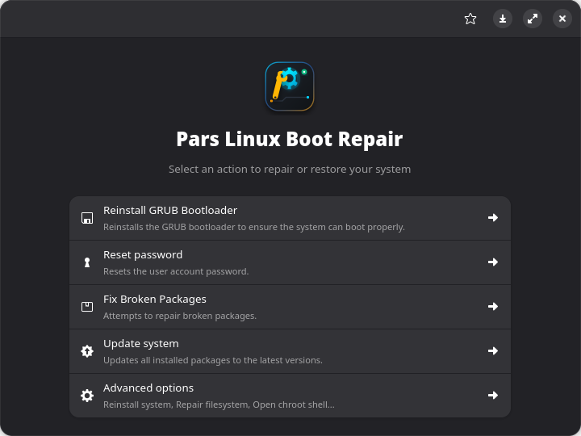
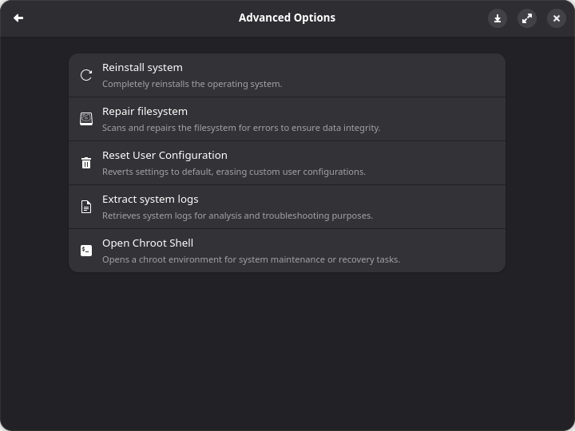
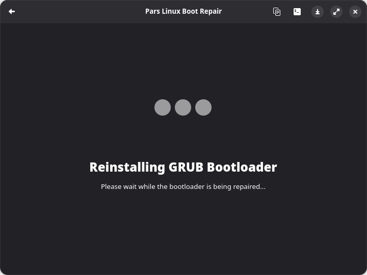
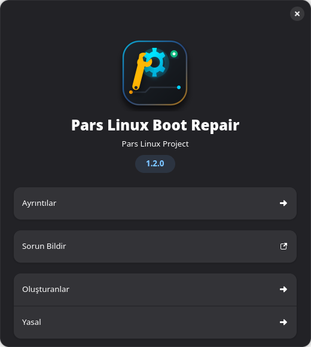

# 🐆 Pars Linux Boot Repair (`parslinux-boot-repair`)

<div align="center">


**Pars Linux modern, hızlı ve güvenli sistem ve önyükleme kurtarma aracı.**  
*Bozulmuş GRUB, EFI/UEFI önyükleme kayıtları, şifre sıfırlama ve dosya sistemi onarımlarını tek tıkla grafiksel arayüzle çözün.*

[](LICENSE)
[](https://parslinux.org)
[](https://python.org)
[](https://gitlab.gnome.org/GNOME/libhandy)
[]()

</div>

---

## 🚀 Genel Bakış

**Pars Linux Boot Repair**, hem canlı (Live USB) ortamında hem de kurulu sistemlerde karşılaşılan önyükleme ve yapılandırma sorunlarını kolayca onarmak için geliştirilmiş gelişmiş bir yardımcı araçtır.

Pardus ekibinin `pardus-boot-repair` projesinden çatallanmış (fork); ParsLinux görsel kimliği, çoklu dağıtım desteği, bağımsız betik otomasyonu, Arch Linux (`PKGBUILD`) desteği ve otomatik test paketi ile baştan sona güçlendirilmiştir.

---

## ✨ Temel Yetenekler & Özellikler

- 🛠️ **Otomatik GRUB & EFI/UEFI Onarımı**:
  - BIOS (Legacy / MBR) ve modern UEFI (x86_64, IA32) önyükleyicilerini otomatik tespit eder ve yeniden kurar.
  - Windows önyükleyici üzerine yazılmış (hardcoded Windows Boot Manager) anakart BIOS'ları için akıllı EFI yedekleme ve baypas köprüsü içerir.
  - Pars Linux (`/boot/efi/parslinux/`), Pardus ve Debian EFI hedeflerini tam destekler.
- 🔑 **Kök ve Kullanıcı Parolası Sıfırlama**:
  - Şifresini unuttuğunuz kurulu sistemin parolasını doğrudan grafik arayüzden veya CLI üzerinden güvenle sıfırlar (`SHA-512` / `openssl passwd -6`).
- 📁 **Çoklu Dosya Sistemi Onarımı (fsck & BTRFS)**:
  - `ext4`, `btrfs`, `vfat`, `ntfs`, `xfs` dosya sistemlerini otomatik algılar.
  - BTRFS alt hacimlerini (`subvolumes`) ayrıştırıp kök bağlama işlemini gerçekleştirir.
- 🔐 **LUKS & LVM2 Desteği**:
  - Şifreli diskleri (`cryptsetup / LUKS`) ve LVM2 mantıksal hacim gruplarını grafik arayüzden şifresini sorarak çözer ve onarıma açar.
- 🐧 **Tek Tıkla Chroot Kabuğu**:
  - Hedef kurulu sisteme API bağlamalarını (`/dev`, `/proc`, `/sys`, `/sys/firmware/efi/efivars`) güvenle bağlayarak root veya normal kullanıcı olarak terminal kabuğu açar.
- 📦 **Bozulmuş Paketleri Onarma (`apt -f install`)**:
  - Yarıda kesilmiş güncelleme ve bozuk bağımlılıkları kurulu sistem chroot içinde otomatik onarır.
- 📊 **Detaylı Teşhis ve Sistem Günlükleri Çıkarma**:
  - Çöken sistemin `/var/log/*`, `dpkg.log`, `sources.list`, `grub.cfg` ve kurulum günlüklerini tek bir ZIP arşivinde toplar.

---

## 🖥️ Ekran Görüntüleri

| Ana Karşılama Ekranı | Gelişmiş Kurtarma Seçenekleri |
| :---: | :---: |
|  |  |

| Çalışma Esnası (Canlı VTE Konsolu) | Hakkında Diyaloğu |
| :---: | :---: |
|  |  |

---

## 🛠️ Kurulum & Paketleme

### 1. Hazır Paketlerden Kurulum

#### Debian / Ubuntu / ParsLinux (`.deb`):
```bash
# Paket oluşturma
./package.sh --deb

# Kurulum
sudo dpkg -i dist/parslinux-boot-repair_*.deb
sudo apt-get install -f
```

#### Arch Linux / CachyOS / Manjaro (`.pkg.tar.zst`):
```bash
# Paket oluşturma
./package.sh --arch

# Kurulum
sudo pacman -U dist/parslinux-boot-repair-*.pkg.tar.zst
```

### 2. Kaynak Koddan Doğrudan Kurulum (Makefile):
```bash
# Kaynakları ve dil çevirilerini derleyin
make build

# Sisteme kurun
sudo make install
```

---

## 🚀 Geliştirici ve Yönetim Araçları

Pars Linux projelerine özgü modüler betik otomasyonu sunulmaktadır:

| Betik | Görev / Açıklama |
| :--- | :--- |
| **`./manage.sh`** | Tüm geliştirme, derleme, test ve paketleme adımlarını yöneten ana orkestrasyon aracı |
| **`./run.sh`** | Uygulamayı başlatır (`--dev` ile root olmadan geliştirici modunda açar) |
| **`./run.sh --test`** | Birim ve doğrulama test paketini çalıştırır (`tests/test_boot_repair.py`) |
| **`./package.sh`** | Otomatik olarak hem `.deb` hem `.pkg.tar.zst` paketlerini derler (`dist/`) |
| **`./install.sh`** | Doğrudan sisteme kurar ve masaüstü / simge veritabanlarını günceller |
| **`./uninstall.sh`** | Sistemden tamamen temizler |
| **`./stop.sh`** | Arka planda çalışan oturumları güvenle sonlandırır |
| **`./update-translations.sh`** | Çeviri şablonunu (`.pot`) yeniler ve `.mo` dosyalarını derler |

---

## 🧪 Testleri Çalıştırma

Otomatik test paketi; Python ve Bash sözdizimlerini, PolicyKit yetki XML'ini, GResource derleme doğruluğunu ve işletim sistemi algılama simülasyonunu test eder:

```bash
./manage.sh test
# veya
python3 -m unittest discover -s tests -v
```

---

## 📂 Dizin Yapısı

```
parslinux-boot-repair/
├── assets/                     # İkonlar, logolar ve ekran görüntüleri
├── debian/                     # Debian paketleme metadata ve changelog
├── dist/                       # Derlenen .deb ve .pkg.tar.zst paketleri
├── mo/                         # Derlenmiş yerel dil dosyaları (tr, pt)
├── po/                         # GNU Gettext çeviri kaynakları (.po, .pot)
├── src/
│   ├── Main.py                 # Ana GTK3 / Libhandy pencere mantığı
│   ├── data/
│   │   ├── images/             # SVG vektör simgeler
│   │   ├── ui/                 # AppWindow.ui Glade arayüz tanımı
│   │   ├── *.desktop           # XDG Masaüstü başlatıcı tanımları
│   │   ├── *.policy            # Polkit (pkexec) yetki kuralları
│   │   └── *.gresource.xml     # GLib GResource şeması
│   └── scripts/                # Çekirdek kurtarma kabuk betikleri
│       ├── check-filesystem    # fsck / btrfs onarım motoru
│       ├── dump-info-log       # Sistem günlüklerini paketleme
│       ├── fix-broken-packages # APT paket tamir motoru
│       ├── full-upgrade        # Canlı chroot yükseltme betiği
│       ├── grub-reinstall      # GRUB ve EFI yeniden kurulumu
│       ├── parslinux-chroot    # Akıllı chroot köprüsü
│       ├── parslinux-mount-rootfs # Kök dosya sistemi bağlayıcı
│       ├── parslinux-open-luks-lvm # LUKS / LVM2 çözücü
│       ├── parslinux-reinstall # Canlı medyadan temiz sistem tazeleme
│       ├── reset-password      # Parola sıfırlama motoru
│       └── search-operating-system # İşletim sistemi ve EFI algılama
├── tests/                      # Otomatik test paketi
├── manage.sh                   # Ana yönetim komut dosyası
├── run.sh                      # Çalıştırma betiği
├── package.sh                  # Paket oluşturucu
├── install.sh                  # Kurulum betiği
├── uninstall.sh                # Kaldırma betiği
├── stop.sh                     # Süreç durdurucu
├── Makefile                    # Standart GNU Make derleme dosyası
├── setup.py                    # Python setuptools kurulum dosyası
├── PKGBUILD                    # Arch Linux paket tanımı
└── README.md                   # Bu belge
```

---

## ⚖️ Lisans ve Telif Hakkı

- **Pars Linux Sürümü:** © 2026 Pars Linux Project (<dev@parslinux.org>)
- **Orijinal Kod Tabanı:** © 2021-2024 TUBITAK ULAKBIM / Pardus (Ali Rıza Keskin, Fatih Altun)
- **Lisans:** [GNU General Public License v3.0 (GPL-3.0-or-later)](LICENSE)
